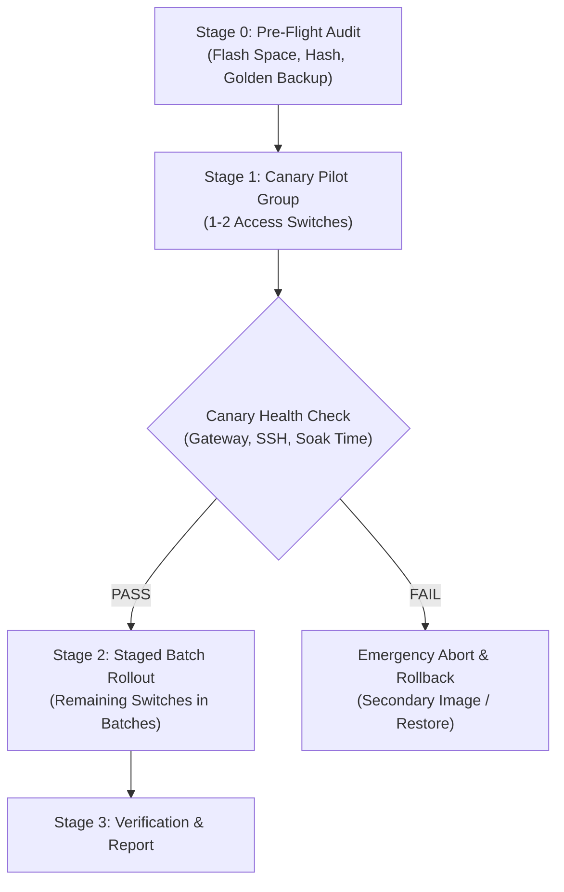

# Firmware Multi-Stage Canary Rollout: Design Specification

**Feature:** Deep Tech — «Firmware Multi-Stage Canary Rollout»  
**Date:** 2026-11-24  
**Target Hardware:** SNR NAG (SNR-OS) & MikroTik RouterOS (v6 & v7)  
**Status:** Approved / In Progress

---

## 1. Intent & The Why

Firmware upgrades in enterprise networks are traditionally high-stress events. A single corrupted image, inadequate flash memory, or unexpected boot failure on a core or aggregation switch can isolate an entire building or campus.

**Firmware Multi-Stage Canary Rollout** eliminates this risk by introducing automated pre-flight safeguards, mandatory pre-upgrade backups, pilot canary verification, post-reboot health checks, and automated rollback/abort mechanisms tailored for SNR NAG and MikroTik RouterOS.

---

## 2. Hardware-Specific Workflows & Commands

### 2.1 SNR NAG (SNR-OS)
- **Version & Flash Space Audit:**
  - `show version` $\rightarrow$ parses current software version.
  - `dir` $\rightarrow$ parses free flash space in bytes.
- **Pre-Flight Golden Backup:**
  - `copy running-config startup-config` and snapshot capture of running configuration.
- **Image Staging:**
  - SCP / SFTP upload to `flash:` or TFTP `copy tftp: flash:`.
  - Image integrity verification via SHA256/MD5.
  - Set boot image: `boot system flash:<new_image.bin>`.
  - Preserve secondary boot image for automatic boot rollback: `boot backup flash:<old_image.bin>`.
- **Reboot & Health Check:**
  - `reload` (with confirmation).
  - Post-boot ICMP ping & management SSH verification.

### 2.2 MikroTik RouterOS (v6 & v7)
- **Version & Disk Space Audit:**
  - `/system resource print` $\rightarrow$ parses `version`, `architecture-name`, `free-hdd-space`.
- **Pre-Flight Backup:**
  - `/system backup save name=pre-upgrade-backup`
  - `/export file=pre-upgrade-export`
- **Package Staging:**
  - SCP / SFTP upload of `.npk` package (e.g. `routeros-7.14-arm64.npk`) to root flash.
  - Integrity check against RouterOS package signature / SHA256.
- **Reboot & Dual Partition Safeguard:**
  - `/system part copy` / dual boot partition fallback if available.
  - `/system reboot`
  - Post-boot `/system routerboard print` $\rightarrow$ `/system routerboard upgrade`.

---

## 3. Canary Multi-Stage Pipeline Stages

1. **Stage 0: Pre-Flight Guardrails**
   - Free flash space check: Target switch must have $\ge \text{Firmware Size} \times 1.25$ free space.
   - Golden baseline config backup created and verified.
   - Core switch protection: Core/Distribution switches cannot be canary targets; they are placed in the final batch.
2. **Stage 1: Canary Pilot Group**
   - 1 or 2 non-critical access switches updated first.
   - Firmware image staged and reboot triggered.
3. **Stage 2: Post-Reboot Health Check (Soak Window)**
   - Wait up to 180s for switch to come back online.
   - Verify ICMP ping reachability.
   - Verify SSH management connectivity and new software version string.
   - Verify default gateway reachability from the switch.
   - If Canary health check fails $\rightarrow$ Trigger Emergency Abort, preserve error logs, and notify engineer.
4. **Stage 3: Staged Batch Rollout**
   - Updates remaining switches in configurable batches (default 2 at a time).
   - If any batch member fails $\rightarrow$ halt rollout immediately.

---

## 4. REST API Contract

1. `GET /api/firmware/catalog`
   - Returns available firmware images: `{ images: [{ id, filename, vendor, version, sizeBytes, sha256 }] }`.
2. `POST /api/firmware/preflight`
   - Body: `{ switchIds: string[], firmwareId: string }`
   - Returns: `{ results: [{ switchId, canUpgrade: boolean, freeSpaceBytes, requiredSpaceBytes, currentVersion, warnings: [] }] }`.
3. `POST /api/firmware/rollout/start`
   - Body: `{ switchIds: string[], canarySwitchIds: string[], firmwareId: string, batchSize?: number, autoRollback?: boolean }`
   - Returns: `{ rolloutId: string, status: "RUNNING" }`.
4. `GET /api/firmware/rollout/status`
   - Returns current rollout state, stage progress, active switch logs, and canary health status.
5. `POST /api/firmware/rollout/abort`
   - Cancels active rollout, aborts pending reboots.

---

## 5. UI / UX Design in `FirmwareRolloutModal.jsx`

- Interactive wizard with 4 steps:
  1. **Select Target Switches & Firmware Image** (with model compatibility filter).
  2. **Pre-Flight Guardrail Scan** (disk space gauge, hash check, config snapshot).
  3. **Canary & Batch Strategy** (designate canary pilot switch, set batch concurrency).
  4. **Live Execution Timeline** (real-time progress bar, switch status cards, live terminal logs, emergency abort button).
