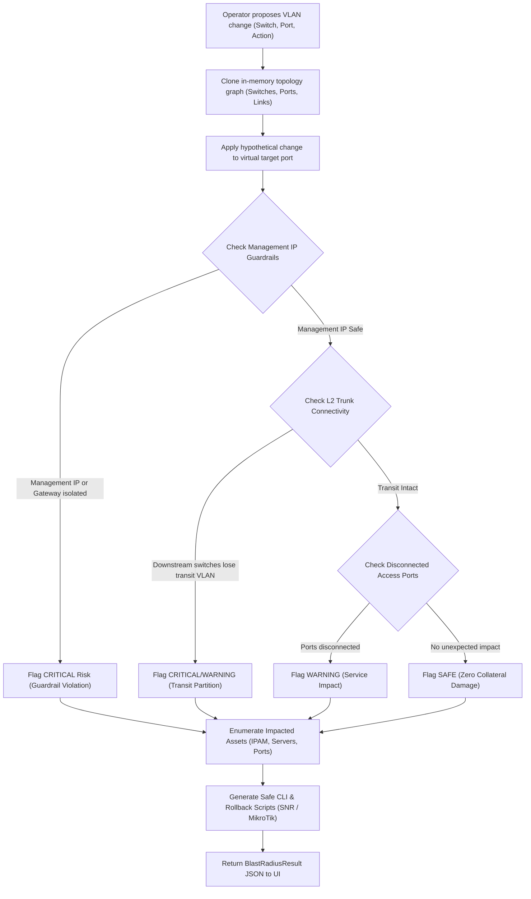

# Game Changer №3: «VLAN Blast Radius Simulator» Design Document

- **Status:** Draft (Under Review)
- **Author:** Product Engineering & Network Architecture
- **Date:** 2026-11-24
- **Target Platforms:** SNR NAG (SNR-OS) and MikroTik RouterOS (v6/v7)

---

## 1. Intent and Context

In campus and datacenter L2/L3 enterprise networks, unauthorized or mistaken configuration changes to VLANs on ports and trunks are the leading cause of unexpected service outages. Typical human errors include:
1. **Pruning transit VLANs from a trunk port:** An engineer removes a VLAN from an uplink trunk, unintentionally severing L2 connectivity to downstream access switches, Wi-Fi APs, and CCTV cameras.
2. **Severing Management IP / Default Gateway path:** Reconfiguring a native VLAN, PVID, or trunk allowed list drops the switch's own Management IP from the network or cuts off monitoring.
3. **Blackholing IPAM and critical servers:** Changing an access port VLAN without realizing an important server, PBX, or storage target resides on that port.

**VLAN Blast Radius Simulator** provides an interactive "Dry-Run" Sandbox. Before committing any change to database or hardware, the engine simulates the modification in-memory over the full topology graph, enumerates the exact blast radius (impacted switches, subnets, servers, and IPAM records), verifies Guardrails, assigns a risk score, and generates safe, vendor-native CLI scripts for SNR NAG and MikroTik RouterOS with matching rollback commands.

---

## 2. Goals, Non-Goals, and Anti-Goals

### Goals
- **Graph Topology Impact Simulation:** Build an in-memory clone of the network graph (switches, ports, links, subnets, servers) and evaluate the connectivity delta caused by any proposed VLAN reconfiguration.
- **Management Reachability Guardrails:** Detect if any switch in the network loses connectivity to its Default Gateway, management IP subnet, or SwitchBook monitoring host.
- **Downstream Switch & Transit Partitioning Detection:** Detect if intermediate trunks lose a VLAN that downstream switches depend on for active access ports.
- **Service & Asset Blast Radius:** Enumerate all impacted IPAM subnets, IP allocations, servers, cameras, and access ports.
- **Risk Scoring:** Assign a clear severity badge:
  - 🔴 `CRITICAL`: Management IP lost, Default Gateway unreachable, or transit trunk severed isolating downstream switches.
  - 🟡 `WARNING`: Access ports / servers disconnected, or asymmetric VLAN tagging mismatch created with peer port.
  - 🟢 `SAFE`: Localized change with zero unintended collateral damage.
- **Safe Multi-Vendor CLI Generation:** Generate idempotent, verified configuration commands and corresponding rollback scripts for SNR NAG and MikroTik RouterOS.
- **1-Click Execution with Guardrails:** Allow applying the change directly to the database and optionally over SSH to physical hardware.

### Non-Goals
- **L3 Dynamic Routing Protocols:** Simulation of OSPF, BGP, or RIP convergence is out of scope. Focus strictly on L2 broadcast domains, 802.1Q tagged/untagged memberships, and L3 management host reachability.
- **Packet-Level Bit Emulation:** We do not build an in-memory packet forwarder/emulator (like GNS3/EVE-NG); rather, we perform structural graph connectivity validation.
- **Cisco-Specific Proprietary Protocols:** No support for Cisco VTP or PVST+. Focus exclusively on standard IEEE 802.1Q on SNR NAG and MikroTik.

### Anti-Goals
- **Never allow blind execution without impact visibility:** An engineer must never be able to execute an SSH command that severs their own management connection without an explicit critical override warning.

---

## 3. Constraints

- **Vendors:** Target **SNR NAG** (SNR-OS) and **MikroTik RouterOS** (v6 Bridge / v7 Bridge VLAN Filtering).
- **Topology Formats:** Must handle arbitrary network topologies: Star, Tree, Ring (RSTP/MSTP), and Mesh without infinite loops (visited set tracking in BFS/DFS).
- **Performance:** Simulation over a 200-switch network must execute in under **50ms**.

---

## 4. Approaches Considered

### Approach 1: Client-Side Live Graph Simulator in React (UI-Only)
- Run BFS traversal in browser memory using React hooks (`useMemo`).
- **Trade-offs:** Fast feedback in UI, but logic cannot be reused by backend services, automated audits, or REST API scripts. Fails to enforce server-side Guardrails when changes are submitted via API.

### Approach 2: Unified Graph-Analysis Engine on Backend + Interactive Sandbox UI (Selected)
- Implement `server/vlanBlastRadiusEngine.js` with comprehensive graph traversal, Guardrails, and CLI generation.
- Expose REST API endpoints: `POST /api/vlan-simulator/simulate` and `POST /api/vlan-simulator/apply`.
- Frontend provides an interactive dialog `src/components/VlanBlastRadiusModal.jsx` with impact cards, risk pills, mini-topology diff, and safe execution button.
- **Why selected:** Ensures 100% test coverage with `node --test`, guarantees Guardrails are enforced on all paths, and provides a rich, responsive operator experience.

### Approach 3: Virtual Configuration Parsing & Shadow Switch State
- Load raw switch configs into a virtual parser and simulate line-by-line CLI execution.
- **Trade-offs:** Extremely fragile, high maintenance overhead, unnecessary complexity for L2 VLAN reachability.

---

## 5. Technical Architecture & Interfaces

### 5.1 Resolution & Reachability Model (Builder Calls)

1. **Management Plane Anchor & Subnet Inference:**
   - Management VLAN is determined automatically by matching each switch's `ip` (e.g. `192.168.1.10`) against VLAN subnets in `storage.getVlans()` (e.g. `192.168.1.0/24`).
   - The Root Anchor is the Core switch (`role === 'core'` or default gateway switch).
   - If any switch loses L2 path in its management VLAN to the root anchor/gateway, it is flagged as a `CRITICAL` Guardrail violation.

2. **Management Plane Isolation vs. Service Plane Partitioning:**
   - `isolatedSwitches`: Strictly switches that lost **management plane reachability** (SSH/Gateway/Monitoring lost). Severity: `CRITICAL`.
   - `servicePartitions`: Switches that remain manageable, but whose access ports in a pruned VLAN lost upstream transit to that VLAN's gateway. Severity: `WARNING` with asset impact breakdown. This avoids false `CRITICAL` alarms on routine trunk pruning.

3. **Asset Blast Radius Scoping:**
   - Impacted IPAM hosts and servers are strictly scoped to the partitioned switch components and severed ports (resolving both direct switch ports and indirect connections via `patchPanels`). The global corporate subnet is never falsely marked as completely dead.

4. **Dual-Ended Trunk Sync Option:**
   - When modifying an inter-switch trunk port (`linkedSwitchId` present), the engine generates CLI scripts for the local switch, and optionally for the peer switch (`syncPeerPort: true`).
   - For SSH execution, downstream switch changes are applied first, then upstream, ensuring SSH sessions are never severed prematurely.

### 5.2 Backend Engine: `server/vlanBlastRadiusEngine.js`

```javascript
export class VlanBlastRadiusEngine {
  constructor(storage) {
    this.storage = storage;
  }

  /**
   * Simulates a proposed VLAN configuration change.
   * @param {Object} proposal
   * @param {string} proposal.switchId - Switch being modified
   * @param {string|number} proposal.portId - Port being modified
   * @param {string} proposal.action - 'change_access_vlan' | 'remove_trunk_vlan' | 'add_trunk_vlan' | 'set_trunk_vlans'
   * @param {number} [proposal.targetVlanId] - Target VLAN ID
   * @param {number[]} [proposal.targetVlans] - Array of VLAN IDs for trunk
   * @returns {BlastRadiusResult}
   */
  simulate(proposal) { ... }

  /**
   * Checks whether switch management IPs remain reachable from the gateway/monitoring root.
   * @param {Array} clonedSwitches
   * @param {number[]} affectedVlanIds
   */
  verifyManagementReachability(clonedSwitches, affectedVlanIds = []) { ... }

  /**
   * Detects if downstream switches lose transit connectivity for any VLAN.
   */
  detectTransitPartitions(originalSwitches, clonedSwitches, proposal) { ... }

  /**
   * Gathers affected IPAM subnets, IP records, servers, and ports.
   */
  calculateBlastRadiusAssets(clonedSwitches, isolatedSwitchIds, disconnectedPortIds, affectedVlanIds) { ... }

  /**
   * Generates vendor CLI script and rollback commands.
   */
  generateVendorScripts(switchItem, portItem, proposal) { ... }
}
```

### 5.2 Simulation Logic Workflow



### 5.3 Result Schema (`BlastRadiusResult`)

```json
{
  "riskLevel": "CRITICAL" | "WARNING" | "SAFE",
  "riskScore": 85,
  "summary": "Удаление VLAN 10 из транка Gi1/0/28 изолирует 2 коммутатора доступа и 14 IP-адресов.",
  "guardrailViolations": [
    "Коммутатор SW-ACCESS-03 потеряет доступ к шлюзу по умолчанию 192.168.1.1"
  ],
  "brokenLinks": [
    { "fromSwitch": "SW-CORE-01", "fromPort": "Gi1/0/28", "toSwitch": "SW-ACCESS-02", "toPort": "Gi1/0/1", "vlanId": 10 }
  ],
  "isolatedSwitches": [
    { "id": "sw-2", "name": "SW-ACCESS-02", "ip": "192.168.1.22" },
    { "id": "sw-3", "name": "SW-ACCESS-03", "ip": "192.168.1.23" }
  ],
  "affectedServers": [
    { "id": "srv-1", "name": "SRV-PROD-DB", "ip": "10.10.10.5", "vlan": 10 }
  ],
  "affectedIpamHosts": [
    { "ip": "10.10.10.15", "hostname": "cctv-cam-04", "vlan": 10 }
  ],
  "affectedSubnets": [
    { "subnet": "10.10.10.0/24", "vlanId": 10, "name": "Servers LAN" }
  ],
  "affectedPortsCount": 16,
  "cliScript": {
    "vendor": "SNR",
    "commands": [
      "configure terminal",
      "interface GigabitEthernet1/0/28",
      "no switchport trunk allowed vlan 10",
      "exit",
      "write"
    ],
    "rollback": [
      "configure terminal",
      "interface GigabitEthernet1/0/28",
      "switchport trunk allowed vlan add 10",
      "exit",
      "write"
    ]
  }
}
```

### 5.4 REST API Endpoints

- `POST /api/vlan-simulator/simulate`:
  - Body: `{ switchId, portId, action, targetVlanId, targetVlans }`
  - Returns: `BlastRadiusResult`
- `POST /api/vlan-simulator/apply` (Requires engineer or admin role):
  - Body: `{ switchId, portId, action, targetVlanId, targetVlans, applyToHardware, credentials }`
  - Validates Guardrails; blocks execution if `riskLevel === 'CRITICAL'` unless explicit `force: true` is supplied.
  - Applies change to database and optionally executes CLI commands over SSH.

---

## 6. Frontend UI Components

### `src/components/VlanBlastRadiusModal.jsx`
1. **Interactive Control Bar:**
   - Switch Selector & Port Selector.
   - Proposed Action:
     - "Сменить Access VLAN"
     - "Удалить VLAN из транка"
     - "Добавить VLAN в транк"
     - "Задать список разрешенных VLAN"
   - Real-time simulation trigger with debouncing.
2. **Blast Radius Overview:**
   - Hero risk badge (CRITICAL 🔴 / WARNING 🟡 / SAFE 🟢).
   - Metrics grid: Изолированные коммутаторы (X), Пострадавшие серверы (Y), IPAM хосты (Z), Затронутые порты (N).
3. **Guardrails & Warnings Panel:**
   - Highlight any blocked safety violations in bold red.
4. **Impacted Assets Tabbed View:**
   - "Коммутаторы и линки", "Серверы и IPAM", "Сгенерированный CLI-скрипт".
5. **Action Footer:**
   - `[Закрыть]`
   - `[Применить изменения]` (Disabled or requires confirmation dialog if CRITICAL).

---

## 7. What Is Left to the Builder

- Exact BFS queue implementation and graph adjacency matrix caching.
- Tailored formatting of MikroTik `pvid` vs `/interface bridge vlan` commands.
- Visual styling of risk score meter in modal.
